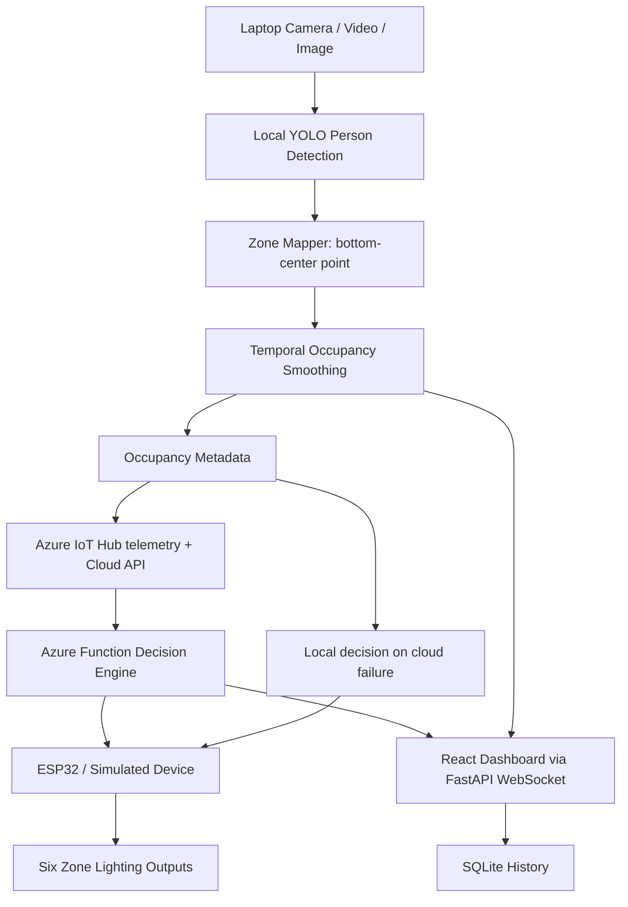

# Architecture

One asynchronous engine owns source, occupancy and commands; API controls share a lock to avoid media/control races. CV inference runs in a worker thread. SQLite stores one complete metadata/decision record each second. Preview JPEGs are served locally and never included in telemetry. Dashboard WebSocket reconnects automatically.

Six occupancy booleans are independent. Occupancy percentage means fraction of occupied zones, not room capacity. People outside all ROIs still count as detected but activate no zone. Simulated cloud runs the decision function in process; real cloud uses authenticated HTTPS and optional IoT Hub telemetry. Cloud errors trigger the same local decision on every tick; subsequent successful calls recover automatically.
