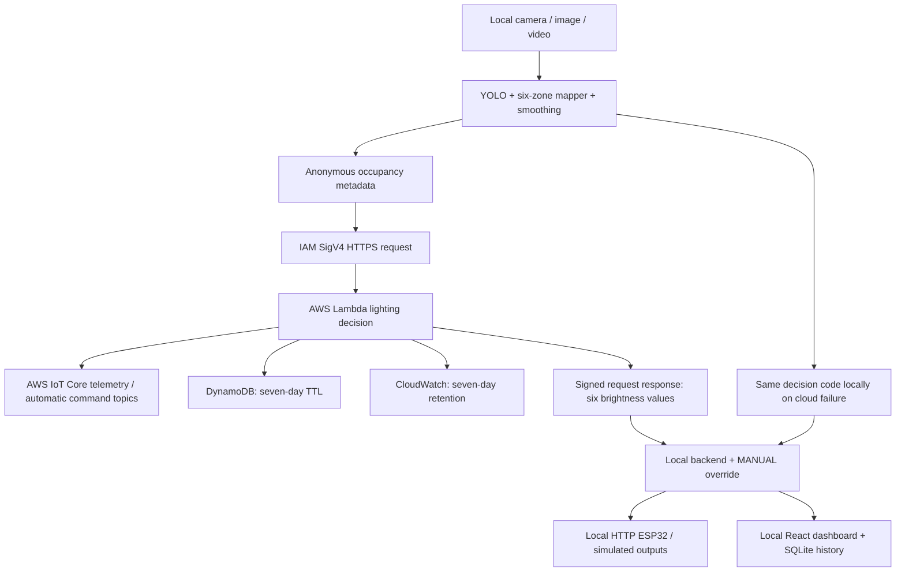

# AWS cloud integration

ZoneLight uses AWS Lambda, AWS IoT Core, DynamoDB and CloudWatch. LIVE_CAMERA, VIDEO_FILE, IMAGE_FILE, SIMULATION, LOCAL_DEMO and simulated ESP32 modes remain available. The laptop keeps camera frames, YOLO, the dashboard and SQLite locally. ESP32 firmware uses a vendor-independent local HTTP bridge; no cloud credentials are embedded in the board.

## AWS path



The Function URL requires AWS_IAM authentication; requests are signed with SigV4 using boto3's credential provider chain. Use an AWS IAM Identity Center profile or other temporary role credentials. Never put AWS credentials in the React bundle. The Lambda execution role can publish only the two topics for its configured classroom, write only its history table, discover the IoT data endpoint, and write logs. The laptop role only needs the stack's invocation policy.

## Deploy your stack

Install the official AWS CLI v2 and AWS SAM CLI. Deployment creates billable resources and requires your AWS account. No stack was provisioned by this migration.

From the repository root:

```powershell
aws configure sso --profile zonelight
aws sso login --profile zonelight
aws sts get-caller-identity --profile zonelight
.\.venv\Scripts\python.exe -m tools.prepare_aws
sam validate --lint --template-file cloud/template.yaml --region ap-south-1
sam build --template-file cloud/template.yaml
sam deploy --guided --profile zonelight --region ap-south-1
```

Choose a stack name such as `zonelight-classroom`. Set ClassroomId to the exact `classroom_id` from config/system_config.json (default CLASSROOM-01). Acknowledge IAM resource creation during your deployment. SAM packages only cloud/; it does not upload camera footage, local uploads, CV weights or the virtual environment. Run prepare_aws and redeploy whenever lighting thresholds or mapping change. The backend rejects cloud commands that disagree with local settings and falls back safely.

Retrieve outputs:

```powershell
aws cloudformation describe-stacks --stack-name zonelight-classroom --profile zonelight --region ap-south-1 --query 'Stacks[0].Outputs'
```

Copy `.env.example` to `.env`, then set AWS_REGION, AWS_PROFILE=zonelight and AWS_LAMBDA_FUNCTION_URL to the FunctionUrl output. Use a role with the LaptopInvokePolicyArn policy attached by your account administrator. Same-account callers need both lambda:InvokeFunctionUrl and lambda:InvokeFunction permissions (the supplied policy includes both). Restart the backend and choose AWS cloud in the dashboard. It should show CLOUD CONNECTED. A configured URL without working credentials activates LOCAL FALLBACK ACTIVE.

## Inspect telemetry and history

In AWS IoT Core's MQTT test client, subscribe to `zonelight/CLASSROOM-01/telemetry` and `zonelight/CLASSROOM-01/commands`. The Lambda publishes metadata and AUTO decisions at QoS 1. Manual output changes remain local and command-topic publication is suppressed in MANUAL mode; the existing ESP32 receives actual manual outputs through the backend. Topic messages are not retained; consumers should enforce a stale-command timeout. MQTT delivery may duplicate messages. The HTTP response remains the authoritative decision path for this implementation; ESP32 does not subscribe directly to IoT Core.

DynamoDB stores occupancy, ambient, proposed automatic brightness and systemMode with a unique recordId and expiresAt. In MANUAL mode these are automatic proposals, not applied output measurements. Seven-day TTL deletion is asynchronous. The dashboard continues to chart local SQLite history; DynamoDB is the cloud audit copy. CloudWatch log group retention is seven days. The table is retained when deleting the stack; remove it separately only if you intentionally want to discard cloud history.

Only classroomId, timestamp, peopleDetected, occupiedZones, ambientLight and systemMode enter the cloud. Lambda rejects missing, unexpected or invalid fields. Per-classroom topic permissions prevent topic/path injection. Real lighting power remains an estimate.

## Failures and cost

Missing credentials, expired SSO login, denied IAM permissions, timeouts, bad responses, mismatched deployment config or failed IoT/DynamoDB writes trigger local fallback. Requests are retried on later engine ticks; successful responses restore the cloud automatically. Simulate Cloud Failure exercises this same fallback. Diagnostics record exception types without printing credentials. If a Lambda request times out, it may still finish and write cloud audit records; unique record IDs preserve them.

Default engine interval is 0.2 seconds: up to five Lambda requests, ten IoT messages and five DynamoDB writes per second while cloud-connected. Use LOCAL_DEMO while not demonstrating, and stop the backend when finished. Lambda concurrency is capped at two; account quotas can prevent deployment of this reservation. Modify it to suit your account if needed. No AWS services are created by merely running LOCAL_DEMO.

To remove the deployed stack yourself:

```powershell
sam delete --stack-name zonelight-classroom --profile zonelight --region ap-south-1
```

The laptop website is still local, and no public frontend hosting is configured. Hosting the camera backend remotely would require a separate local capture agent and authenticated preview transport; the original privacy-first design deliberately keeps it on the laptop.

References: [Lambda IAM URL authentication](https://docs.aws.amazon.com/lambda/latest/dg/urls-auth.html), [SAM FunctionUrlConfig](https://docs.aws.amazon.com/serverless-application-model/latest/developerguide/sam-property-function-functionurlconfig.html), [IoT publish API](https://docs.aws.amazon.com/boto3/latest/reference/services/iot-data/client/publish.html).
