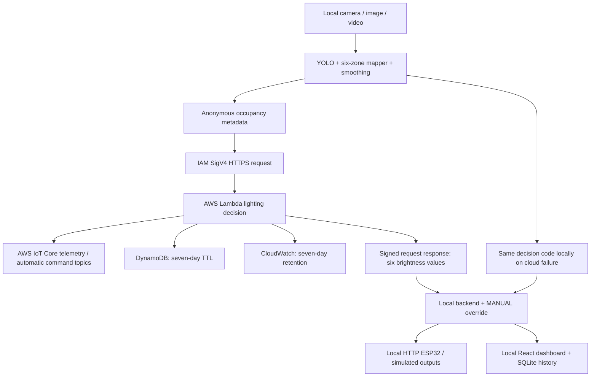

# AWS cloud integration

ZoneLight uses AWS Lambda, AWS IoT Core, DynamoDB and CloudWatch. LIVE_CAMERA, VIDEO_FILE, IMAGE_FILE, SIMULATION, LOCAL_DEMO and simulated ESP32 modes remain available. The laptop keeps camera frames, YOLO, the dashboard and SQLite locally. ESP32 firmware uses a vendor-independent local HTTP bridge; no cloud credentials are embedded in the board.

## AWS path



The Function URL requires AWS_IAM authentication; requests are signed with SigV4 using boto3's credential provider chain. Use the `zonelight` AWS login profile for the new AWS experience, or another temporary role credential provider. Never put AWS credentials in the React bundle. The Lambda execution role can publish only the two topics for its configured classroom, write only its history table, discover the IoT data endpoint, and write logs. The laptop role only needs the stack's invocation policy.

## Deploy your stack

The six-zone stack is deployed as `zonelight-classroom` in `ap-southeast-2`. It uses AWS Free plan credits. Keep the project on the Free plan. AWS CLI v2 is sufficient for deploying the inline Python code; SAM CLI is optional.

From the repository root:

```powershell
aws login --profile zonelight --region ap-southeast-2
aws sts get-caller-identity --profile zonelight
.\.venv\Scripts\python.exe -m tools.prepare_aws
.\.venv\Scripts\cfn-lint.exe cloud/template.yaml -r ap-southeast-2
.\.venv\Scripts\python.exe -m tools.package_aws
aws cloudformation deploy --template-file cloud/deployment-template.json --stack-name zonelight-classroom --capabilities CAPABILITY_IAM --parameter-overrides ClassroomId=CLASSROOM-01 --profile zonelight --region ap-southeast-2
```

Choose a stack name such as `zonelight-classroom`. Set ClassroomId to the exact `classroom_id` from config/system_config.json (default CLASSROOM-01). Acknowledge IAM resource creation during your deployment. The inline packager includes only the Lambda handler, shared decision logic and decision configuration; it does not upload camera footage, local uploads, CV weights or the virtual environment. It requires the existing cfn-lint development dependency. Run prepare_aws and redeploy whenever lighting thresholds or mapping change. The backend rejects cloud commands that disagree with local settings and falls back safely.

Retrieve outputs:

```powershell
aws cloudformation describe-stacks --stack-name zonelight-classroom --profile zonelight --region ap-southeast-2 --query 'Stacks[0].Outputs'
```

Copy `.env.example` to `.env`, then set AWS_REGION, AWS_PROFILE=zonelight and AWS_LAMBDA_FUNCTION_URL to the FunctionUrl output. Use a role with the LaptopInvokePolicyArn policy attached by your account administrator. Same-account callers need both lambda:InvokeFunctionUrl and lambda:InvokeFunction permissions (the supplied policy includes both). Restart the backend and choose AWS cloud in the dashboard. It should show CLOUD CONNECTED. A configured URL without working credentials activates LOCAL FALLBACK ACTIVE.

## Inspect telemetry and history

In AWS IoT Core's MQTT test client, subscribe to `zonelight/CLASSROOM-01/telemetry` and `zonelight/CLASSROOM-01/commands`. The Lambda publishes metadata and AUTO decisions at QoS 1. Manual output changes remain local and command-topic publication is suppressed in MANUAL mode; the existing ESP32 receives actual manual outputs through the backend. Topic messages are not retained; consumers should enforce a stale-command timeout. MQTT delivery may duplicate messages. The HTTP response remains the authoritative decision path for this implementation; ESP32 does not subscribe directly to IoT Core.

DynamoDB stores occupancy, ambient, proposed automatic brightness and systemMode with a unique recordId and expiresAt. In MANUAL mode these are automatic proposals, not applied output measurements. Seven-day TTL deletion is asynchronous. The dashboard continues to chart local SQLite history; DynamoDB is the cloud audit copy. CloudWatch log group retention is seven days. The table is retained when deleting the stack; remove it separately only if you intentionally want to discard cloud history.

Only classroomId, timestamp, classTime, peopleDetected, occupiedZones, ambientLight and systemMode enter the cloud. Lambda rejects missing, unexpected or invalid fields. Per-classroom topic permissions prevent topic/path injection. Real lighting power remains an estimate.

## Failures and cost

Missing credentials, expired SSO login, denied IAM permissions, timeouts, bad responses, mismatched deployment config or failed IoT/DynamoDB writes trigger local fallback. Requests are retried on later engine ticks; successful responses restore the cloud automatically. Simulate Cloud Failure exercises this same fallback. Diagnostics record exception types without printing credentials. If a Lambda request times out, it may still finish and write cloud audit records; unique record IDs preserve them.

Default engine interval is one second: at most one Lambda request, two IoT messages and one DynamoDB write per tick while actively processing an image or laptop camera. Paused and simulated sources do not make cloud requests. Use LOCAL_DEMO while not demonstrating, and stop the backend when finished. Lambda concurrency is capped at two; account quotas can prevent deployment of this reservation. Modify it to suit your account if needed. No AWS services are created by merely running LOCAL_DEMO.

To remove the deployed stack yourself:

```powershell
aws cloudformation delete-stack --stack-name zonelight-classroom --profile zonelight --region ap-southeast-2
```

The laptop website is still local, and no public frontend hosting is configured. Hosting the camera backend remotely would require a separate local capture agent and authenticated preview transport; the original privacy-first design deliberately keeps it on the laptop.

References: [Lambda IAM URL authentication](https://docs.aws.amazon.com/lambda/latest/dg/urls-auth.html), [SAM FunctionUrlConfig](https://docs.aws.amazon.com/serverless-application-model/latest/developerguide/sam-property-function-functionurlconfig.html), [IoT publish API](https://docs.aws.amazon.com/boto3/latest/reference/services/iot-data/client/publish.html).

## Six-zone deployment scope and credit protection

Only six-zone cloud brightness decisions and timestamped student-count records are required. One ESP32 controls six LEDs over the existing laptop HTTP bridge. The older two-zone report is superseded. No Node-RED, Thinger.io or additional sensor dependency is introduced.

The local detector supplies anonymous counts and zone occupancy from an uploaded image or laptop camera. Image grayscale intensity estimates relative ambient brightness; it is not calibrated illuminance in lux. AWS computes the six brightness commands. Records include classroomId, timestamp, peopleDetected and classTime (the UTC start of the camera/image session). Counts are visible people, not unique attendance identities. Existing seven-day history expiry remains enabled.

The loop interval is one second to reduce Lambda, IoT and DynamoDB usage. The AWS project must stay on the FREE plan; do not upgrade to PAID or activate advanced features. Check the remaining credit balance before deployment. AWS expires the Free plan when credits are exhausted or the Free period ends; budget alerts are not a hard cap. Stop local processing when the demonstration ends. No autonomous credit monitor or additional cloud features are deployed.

The history table is retained on stack deletion; preserve its schema and retention policies. Function URL must remain AWS_IAM; the ESP32 receives six values through the local bridge, never AWS credentials. Only the classroom-specific IoT topics and history table are writable by Lambda. CloudTrail has no configured durable trail; AWS event history supplies the default 90-day management audit window.

The laptop checks Free plan status and credit consumption before its first cloud request, then at most once per minute. It subtracts automatic earned bonuses when computing total usage against the original $100 budget. Cloud requests stop at $80 reported consumption, leaving a $20 buffer, or if the Free plan is inactive/changed or billing checks fail. Local fallback then applies. AWS billing data can lag: this is not an exact hard $100 cutoff and only governs this backend, not other AWS workloads. The Free plan prevents paid overages; do not upgrade it. Current balance includes a $20 automatic AWS activity bonus.
